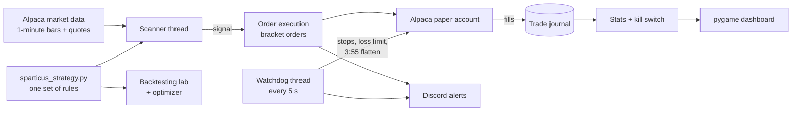

# Sparticus

An automated stock-trading bot for the Alpaca API, with a live "brain" dashboard (pygame), Discord alerts, a trade journal, a backtesting lab with a one-command optimizer, and a weekly review tool.

**Status: experimental. Paper trading only.** It hasn't shown a reliable edge yet. Run it with Alpaca's free paper account (fake money) and treat it as a learning project, not a money printer. Nothing here is financial advice.

## What it does

* Scans a watchlist of stocks every minute (1-minute bars). It buys when the 5-bar average crosses above the 20-bar average and RSI is between 50 and 80.
* Every entry gets a take-profit and a stop at the broker. A watchdog adds a −3% emergency stop and a daily loss limit.
* Sells on a trend reversal after a minimum hold (30 minutes), and closes everything at 3:55 pm ET. It never holds overnight:
  * stopping it during market hours (closing the window, Ctrl+C, closing Terminal) closes its positions first;
  * anything left over from an earlier day (the computer slept, say) is sold one minute after the next open.
* Logs every trade to `sparticus_journal.csv` and shows live stats on the dashboard (press TAB).
* Kill switch: if drawdown passes its limit, autopilot turns itself off.

## How it fits together



The live bot and the lab import the **same** strategy file, so a backtest always describes exactly the rules being traded.

## What I learned building it

* **Measure before you optimize.** The lab showed the first version had no edge, and a review of 206 real paper trades showed why: the 1-minute exit signal cut almost every trade within minutes, and the brackets never filled once.
* **Guard against fooling yourself.** The lab uses out-of-sample testing, a random-entry baseline, Monte Carlo drawdowns, and a t-stat bar that rises with every idea tested.
* **Operations matter as much as strategy.** Real failures were operational: a flatten that didn't verify, a circuit breaker that was called but never defined, a bot that missed 5 of 9 days, and positions left open when the window closed. Each one is now fixed and covered by tests.
* **Secrets never touch the code.** Keys live in `.env`, logs scrub tokens, and a scanner checks every folder before it's shared.

## Setup (Mac or Linux, Python 3.10+)

```bash
cd sparticus
python3 -m venv .venv
source .venv/bin/activate
pip install -r requirements.txt

cp .env.example .env        # then open .env and paste in YOUR OWN Alpaca PAPER keys
python3 -m unittest discover -s tests     # expect: Ran 108 tests ... OK
./run_sparticus.sh hud      # with the dashboard (or ./run_sparticus.sh for no window)
```

Get keys at alpaca.markets: open the **Paper Trading** account, then **API Keys → Generate**. Discord is optional; leave `DISCORD_WEBHOOK_URL` empty to skip it.

* `python3 sparticus_v6_4.py --no-autopilot` starts with autopilot off, so you can watch the dashboard first and press **A** to turn it on.
* **Mac only, optional:** `./install_autostart.sh` starts Sparticus by itself at 9:20 AM every weekday (no window). `./uninstall_autostart.sh` turns that off. The Mac has to be on, logged in and awake.

## Files

| File | What it is |
|---|---|
| `sparticus_v6_4.py` | The bot |
| `sparticus_strategy.py` | **All settings and rules.** The bot and the lab both read this file |
| `sparticus_journal.py`, `sparticus_stats.py`, `sparticus_incubation.py` | Trade journal, statistics, kill switch |
| `backtest.py` | The lab: replays months of history through the same rules |
| `optimize.sh`, `lab_verdict.py` | One-command optimizer: runs the lab on 10 candidates and says what to change, if anything |
| `trade_review.py` | Turns an Alpaca order history into a report |
| `run_sparticus.sh` | Launcher: keeps a Mac awake and restarts the bot if it crashes |
| `install_autostart.sh`, `uninstall_autostart.sh` | Optional weekday autostart (macOS) |
| `scan_for_secrets.py` | Checks a folder for keys and private files before you share it |
| `tests/` | 108 offline tests (no account or internet needed) |
| `.env.example` | Template for your own `.env` |

## Optimizing and the weekly review

```bash
./optimize.sh                         # evenings or weekends; the first run downloads data, give it a while
python3 trade_review.py orders.txt    # review a week of paper trades (Alpaca → Orders, copy the table)
```

`optimize.sh` tests your current settings against alternatives on about 6 months of history. It only trusts a config that passes the whole bar on the months it never tuned on. Then it tells you to keep everything, or exactly which lines to change in `sparticus_strategy.py`. Change one thing at a time and give each change at least two weeks.

## Safety rules

1. **Your keys stay in `.env`.** Never put them in the code, in GitHub, or in a message. `.gitignore` already keeps `.env`, logs and journals out of git.
2. **Keep `ALPACA_PAPER=true`.** `false` means real money.
3. **Before you share your copy with anyone,** run `python3 scan_for_secrets.py`. It must say `OK`.
4. **If a key ever leaks,** delete it in the Alpaca dashboard (API Keys → Regenerate) and update `.env`. For a Discord webhook, delete it in Discord and make a new one.
5. **Read code before you run it,** including changes someone sends back to you.
